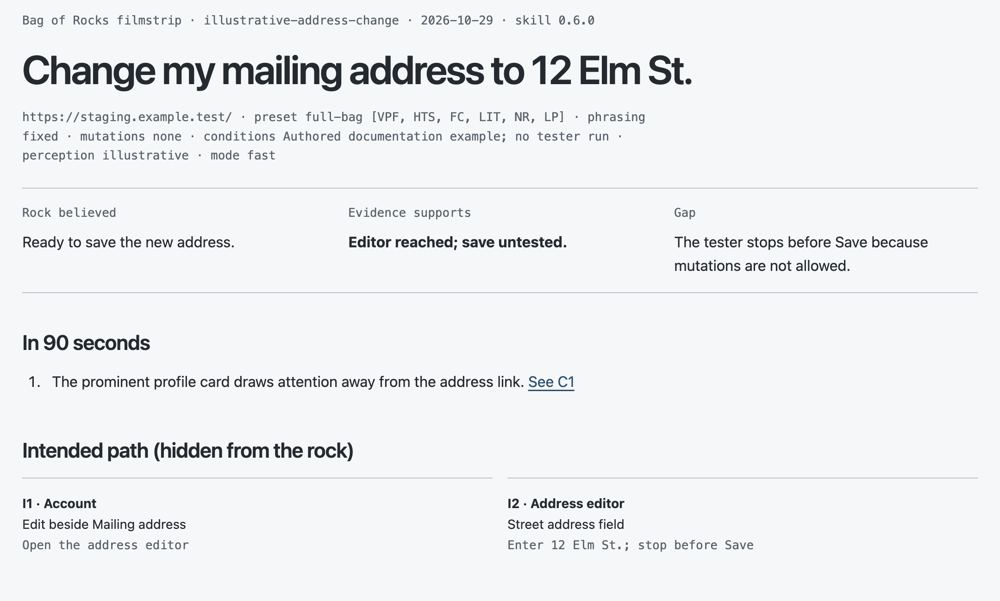
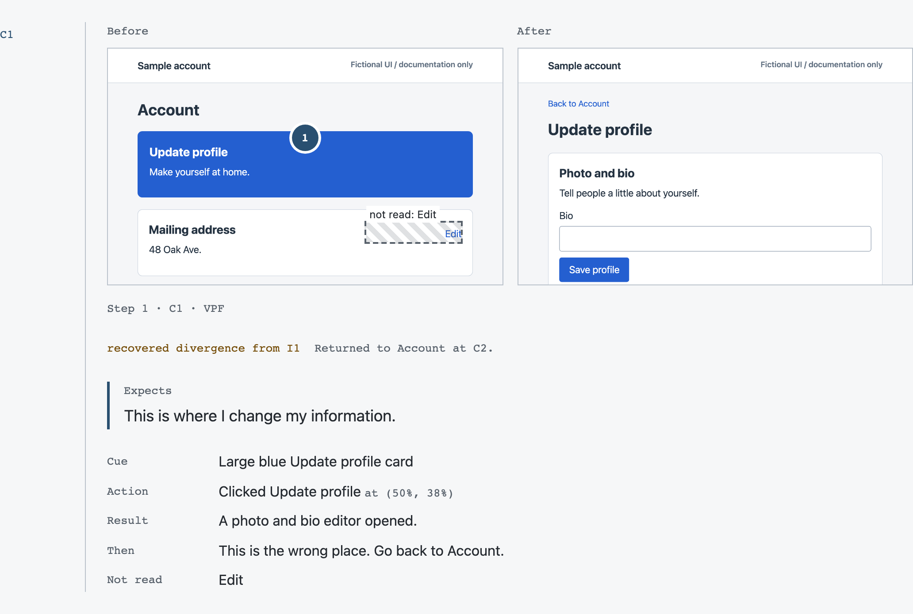
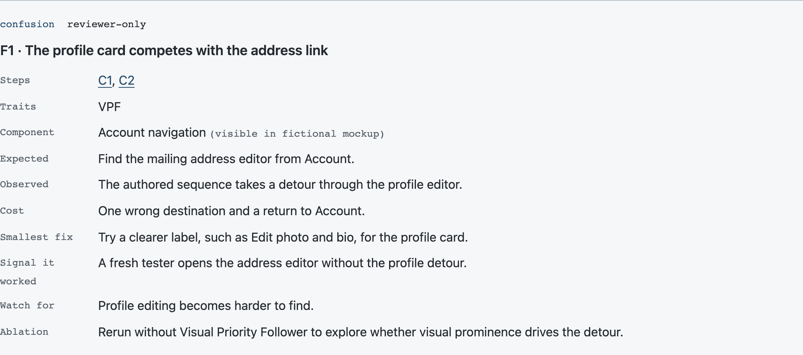

# Bag of Rocks

Give an agent a goal without showing it the route. Watch where it gets stuck, then review an annotated timeline of what happened.

Bag of Rocks is a synthetic UX walkthrough skill. Its tester acts as someone who's unfamiliar with the product, nervous about making mistakes, and unsure around technology.

A coordinator records the intended path and keeps it from the tester. The tester works through the rendered screens, then a reviewer compares its recorded actions with that path. You get an annotated screenshot filmstrip, findings linked to evidence, and saved findings called “rocks” for later regression checks.

**Version:** 0.7.0 · [MIT license](LICENSE) · [Changelog](CHANGELOG.md) · [Provenance](docs/provenance.md)

Use the findings as hypotheses to investigate. They don't establish how real people behave, how many would fail, or whether a product meets accessibility standards.

## What it includes

- Six default behavior traits, a patient preset, and optional traits.
- Fast, multi-persona, ablation, retest, and regression workflows.
- A deterministic packet builder with a SHA-256 digest and neutrality warnings.
- A trace converter that preserves tester files and flags evidence problems.
- A self-contained HTML filmstrip with optional tester calibration controls.
- Seven calibration fixtures: local pages with one planted blind spot each, plus a clean control.

The agent performs the walkthrough. These Python scripts do not launch or control a browser, create a sandbox, or enforce permissions.

## Walk through a sample timeline

This example follows a mailing-address change: a wrong turn, a recovery, and a stop before saving. **The scenario and annotations are authored illustrations, not a completed tester run.** The screenshots show fictional account screens inside the actual filmstrip renderer.



Start with the outcome: what the tester believed, what the evidence supports, and the gap between them. Here, reaching the editor doesn't establish that the address was saved. The intended path appears below for the reviewer; in a real run, the tester never receives it.

| Checkpoint | What happens | What to look for |
| --- | --- | --- |
| C1 — Wrong turn | The tester chooses **Update profile** and reaches a photo and bio editor. | The prominent card wins attention over the smaller address link. |
| C2 — Recovery | It returns to Account and chooses **Edit** beside Mailing address. | The detour is marked as recovered, with a reference to intended step I1. |
| C3 — Stop before Save | It enters `12 Elm St.` and stops at **Save address**. | With mutations disabled, saving is recorded as intent only. |



Read each checkpoint from the screen to the expectation, action, result, and next decision. Numbered circles mark clicks; hatched regions identify cues recorded as not read. `VPF` means Visual-Path Follower, the trait illustrated by this detour. These annotations describe the supplied trace; they aren't eye-tracking measurements.



The finding links back to C1 and C2, proposes **Edit photo and bio** as a clearer label, and names a check for the next run: can a fresh tester reach the address editor without the detour? It also flags what that change might break—making profile editing harder to find.

To explore the full sample locally, generate it from the included [run data](docs/sample-timeline/run.json):

```sh
python3 skills/bag-of-rocks/scripts/trace_to_run.py docs/sample-timeline --filmstrip
```

Open `docs/sample-timeline/filmstrip.html` in a browser. The summary and finding links jump to their checkpoints. The included PNGs come from [fictional screen mockups](docs/sample-timeline/screens.html); no account or private product data is used.

## Requirements

Use an agent with screenshot-based browser control and filesystem access. Give the tester a fresh context when possible; if it already knows the intended path or prior conversation, label the run as an informed pass.

The helpers require Python 3. JSON input needs no additional packages; YAML input requires PyYAML. The skill itself does not require Node.js. Your model and browser providers may charge for usage.

## Install

Bag of Rocks installs as a plugin in Claude Code and Codex, which keeps it updated. Both read the same repository, which serves as its own plugin marketplace.

**Claude Code**, in a session:

```text
/plugin marketplace add mzebley/bag-of-rocks
/plugin install bag-of-rocks@mzebley
```

Run it with `/bag-of-rocks`, or just ask for a UX walkthrough. Get new versions with `/plugin marketplace update mzebley`, or turn on auto-update for the marketplace under **Marketplaces** in `/plugin`. From a shell, use `claude plugin marketplace add`, `claude plugin install`, and `claude plugin update bag-of-rocks@mzebley`.

**Codex** (CLI, desktop app, or IDE extension):

```sh
codex plugin marketplace add mzebley/bag-of-rocks
codex plugin add bag-of-rocks@mzebley
```

Get new versions with `codex plugin marketplace upgrade mzebley`, then start a new thread. In the desktop app you can also install it from the Plugins directory once the marketplace is added.

The marketplace is named `mzebley`, so it can hold more skills later. Both agents list the skill as `bag-of-rocks:bag-of-rocks`, because plugin skills always carry their plugin's name. Updates arrive when the plugin `version` changes, which happens with each release. To stay on one release, add the marketplace at its tag: `mzebley/bag-of-rocks#v<version>` in Claude Code, or `--ref v<version>` in Codex. Tags before the plugin layout (0.6.0 and earlier) have no plugin manifests.

**Any other agent:** `skills/bag-of-rocks/` is a standard [Agent Skills](https://agentskills.io) folder, so any agent that reads `SKILL.md` skills can use it. Copy the folder into the agent's skills directory. `~/.agents/skills/` is read by Codex and Gemini CLI; Claude Code reads `~/.claude/skills/`.

```sh
git clone https://github.com/mzebley/bag-of-rocks.git
cp -R bag-of-rocks/skills/bag-of-rocks ~/.agents/skills/
```

The skills CLI installs it into many agents at once, and `npx skills update` refreshes it:

```sh
npx skills add mzebley/bag-of-rocks --skill bag-of-rocks
```

Copied folders don't update themselves. Release validation has covered the Claude Code and Codex plugins, not the skills CLI or Gemini CLI. Whatever the agent, the skill needs browser control that saves screenshots and, ideally, fresh subagents for the tester.

## Use it

Ask your agent:

```text
Use bag-of-rocks.
Goal: Change my mailing address to 12 Elm St.
Start: https://staging.example.test/
Account: disposable sandbox user
Mutations: none
Preset: full-bag
Budget: one run, 25 actions
```

Replace the fictional URL and address with your authorized staging URL and test data. With `Mutations: none`, the tester stops before saving the address and records what it would have done. Use `Mutations: allowed` only when changes are authorized in your sandbox or staging environment.

The coordinator confirms the intended path with you, then gives a fresh tester a fixed packet of instructions that excludes that path. See [SKILL.md](skills/bag-of-rocks/SKILL.md) for the workflow and [coordinator guidance](skills/bag-of-rocks/references/coordinator.md) for modes and run structure.

To try the helper without any browser activity, from this repository:

```sh
mkdir -p /tmp/bag-of-rocks-example/tester
cp examples/run-params.json /tmp/bag-of-rocks-example/run-params.json
python3 skills/bag-of-rocks/scripts/build_packet.py /tmp/bag-of-rocks-example/run-params.json --strict
```

Edit the example's `output_dir` to the absolute tester directory before a real run. Its placeholder output path is only for inspecting a packet. Keep credentials out of parameters. Include every applicable safety boundary in `prohibited_effects`; the packet builder is not a safety sandbox. A nonzero `--strict` exit still leaves packet files behind: do not hand them off until warnings are resolved.

After a tester has produced `tester/trace.json` and screenshots:

```sh
python3 skills/bag-of-rocks/scripts/trace_to_run.py /path/to/run
# Reviewer fills outcome, summary, findings, and divergences in run.json.
python3 skills/bag-of-rocks/scripts/trace_to_run.py /path/to/run --filmstrip
```

For tester calibration, add `--calibration` to the `--filmstrip` command. This enables plausibility verdicts and their export controls; ordinary reports omit them.

The first conversion writes `tester.sha256`; later conversions report any tester file that changed. `--force` regenerates `run.json` while keeping the reviewer's outcome, findings, assumption status, divergences, and notes.

Convert only trusted local traces, and inspect them first. The converter rejects screenshot paths outside `tester/` but is not hardened for arbitrary downloaded inputs. It reads PNG and JPEG dimensions, but cannot decode WebP dimensions. Keep the tester directory unchanged and include conversion warnings in the report’s Limits section.

## Try it on the fixtures

The skill's `fixtures/` folder holds a small fictional community-center site with one planted blind spot per page, such as a hint-only date format or a submit button with no loading state. Use it to see a full run without a staging site, or to check the tester after changing a trait.

```sh
python3 -m http.server 8000 --bind 127.0.0.1 --directory skills/bag-of-rocks/fixtures/site
python3 skills/bag-of-rocks/fixtures/new_run.py hint-only-format
```

`new_run.py` creates a run folder with its intended path and a strict packet, then prints the start URL. Give a fresh tester the packet, then convert the trace as above. See the [fixtures README](skills/bag-of-rocks/fixtures/README.md) for each fixture and what it should expose.

## Validation and contributions

```sh
python3 -m unittest discover -s tests -v
```

Tests use disposable files to check packet blinding, hashes, trace conversion, and filmstrip generation. They do not operate a browser. See [validation](docs/validation.md) for the recorded checks and their limits.

When contributing a change, include a small reproducible fixture, the observed behavior, and any effect on the evidence trail. Keep real run screenshots, account data, credentials, and private product examples out of commits.

## Distribution and related work

Version 0.7.0 is published on [npm](https://www.npmjs.com/package/bag-of-rocks/v/0.7.0) and as a [GitHub release](https://github.com/mzebley/bag-of-rocks/releases/tag/v0.7.0). The plugin install above is the recommended path. The npm package distributes the same files: use `npm pack bag-of-rocks` to download the archive, then copy its skill folder as described above. npm does not register the skill with your agent. See the [distribution record](docs/release.md) for details.

[Related work](docs/related-work.md) covers other approaches to simulated users and UX inspection. Bag of Rocks focuses on an uncoached persona pursuing a goal, with a chronological record for review. The comparison is preliminary, not a benchmark.
